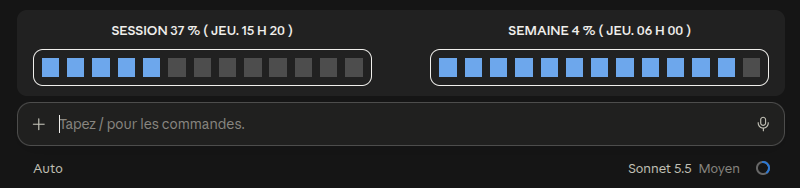

# usage-band



**FR** — Mod pour l'application Claude (desktop) qui affiche, au-dessus de la zone de message, deux barres segmentées :

- **SESSION** (limite de 5 h) : la barre se remplit à mesure que la limite est consommée.
- **SEMAINE** : la barre se vide à mesure que la limite est consommée.
- Couleurs du thème ; orange dès 70 % utilisés, rouge dès 90 %.
- Le texte indique le pourcentage et l'heure de remise à zéro.

**EN** — A mod for the Claude desktop app that shows two segmented usage bars above the prompt box: the 5-hour **session** limit (fills up) and the **weekly** limit (drains). Turns orange at 70 % and red at 90 % used.

## Installation

Dans Claude Code / In Claude Code:

```
/plugin marketplace add icefrogqc/usage-band
/plugin install usage-band@usage-band
```

Accepter la question « Enable hot reloading for this session? » si elle apparaît / Accept the hot-reloading prompt if shown.

## Personnalisation / Customization

Dans `plugins/usage-band/hooks/register.tsx` : `SEGMENTS` (nombre de blocs), seuils de couleur (70 / 90), libellés `LABELS`.

## Notes

- Testé avec l'application Claude desktop sur Zorin OS / Ubuntu 24.04. Le moteur de mods peut différer selon la plateforme.
- Aucune donnée n'est envoyée : le mod lit seulement l'utilisation de la session locale.

## Licence / License

MIT — voir [LICENSE](LICENSE).
